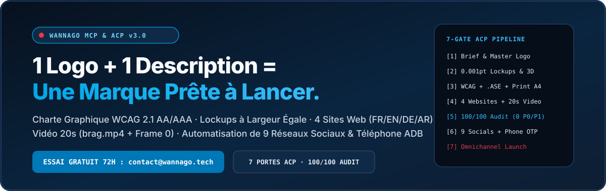

<div align="center">
  
  <br/><br/>
  <a href="mailto:contact@wannago.tech?subject=Demande%20Cle%20Essai%20Gratuit%203%20Jours%20WannaGo%20MCP"></a>
  <a href="https://wannagotech.github.io/wannago-mcp/"></a>
  <a href="https://github.com/WannaGoTech/wannago-mcp/issues/new/choose"></a>
</div>

---

# WannaGo MCP & ACP — All-in-One AI Brand Identity, Production Website, 20s Launch Video & 9-Platform Social Media Server

> **Logo + Business Description = A 100/100 Certified Brand Ready to Launch in One Shot.**
> Développé par **WannaGoTech** · Contact & Clé d'Essai Gratuit 3 Jours (72h) : **[contact@wannago.tech](mailto:contact@wannago.tech?subject=Demande%20Cle%20Essai%20Gratuit%203%20Jours%20WannaGo%20MCP)**

---

## Pourquoi WannaGo MCP & ACP ? (FR)

**WannaGo MCP** (`wannago-mcp`) est le premier serveur **Model Context Protocol (MCP)** et **Agent Control Protocol (ACP)** tout-en-un qui transforme seulement **2 entrées** dans votre chat (**1. Votre Logo** + **2. Votre Description**) en un écosystème de marque complet, audité à **100 / 100** et prêt à être publié sur **9 réseaux sociaux** :

1. **Suite Logo Vectorielle & Lockups à Largeur Mathématiquement Égale (`01_Logos/`, `02_Logo_3D_and_Animations/`, `03_Favicons_and_App_Icons/`)**
   - Conservation intacte de votre logo maître ou synthèse vectorielle automatique (`logoPath: "auto"`).
   - Alignement mathématique sous-pixel : `Largeur Ligne 2 == Largeur Ligne 1` à `0.001pt`.
   - Icônes d'application **Squircle 1024×1024** (`22.37%` rayon continu, `>10%` marge optique), `favicon.ico` multi-couches et **Studio 3D interactif** (`1.022` échelle).
2. **Palette Certifiée WCAG 2.1 AA/AAA, Nuancier Adobe `.ASE`, Papeterie Print A4 & Signatures Outlook 600px (`04_Headers/`, `05_Email_Signatures/`, `07_Brand_Colors/`)**
   - Calcul de luminance relative et synthèse automatique d'un token d'encre profonde accessible (`>= 5.0:1` sur fond clair).
   - Fichier binaire **Adobe Swatch Exchange (`.ase`)** pour Illustrator, Photoshop et InDesign.
   - En-têtes de lettres A4 vectoriels, bannières réseaux sociaux ajustées sans coupure de texte et signatures email `600px` (`tabular-nums`, isolation BiDi RTL).
3. **Sites Web de Production Multilingues (`FR, EN, DE, AR`), Brand Hubs & Chartes PDF HD (`09_Commercial_Presentations_A4/`, `11_Production_Website/`)**
   - Génération du contrat `DESIGN.md` + **4 Sites Web de Production** (6 anatomies de sections distinctes, grille Bento avec cellule dominante 2×2, 8 états interactifs, support natif RTL Arabe).
   - **4 Brand Hubs HTML5**, **4 Manuels de Charte Graphique PDF HD** et **4 Présentations Commerciales A4**.
4. **Vidéo de Lancement 20 Secondes (`brag.mp4` + Miniature `brag.jpg` en Frame 0 + `share-copy.txt`)**
   - Vidéo `1920×1080` (16:9) ou `1080×1920` (9:16) à 30fps synchronisée sur les temps forts musicaux + effets sonores + miniature `brag.jpg` incrustée directement en **Frame 0** pour un affichage parfait sur X, LinkedIn, Slack et Discord.
5. **Création de Comptes (Navigateur & Téléphone Mobile Android) + Gestion de 9 Réseaux Sociaux**
   - Automatisation complète sur **X (Twitter), LinkedIn, Instagram, Facebook, TikTok, YouTube, Bluesky, Threads et Reddit** : création de comptes avec extraction automatique des codes SMS OTP sur téléphone Android connecté via ADB, publication (`dryRun` et direct), planification, analytiques, boîte de réception, réponses, DM et veille de tendances.

---

## Essai Gratuit 3 Jours (72h) & Clé de Sécurité (`WANNAGO_API_KEY`)

L'exécution des 23 outils de **WannaGo MCP** est protégée par une clé de licence cryptographique signée (`WANNAGO_API_KEY`) :

| Formule | Préfixe de Clé | Durée & Fonctionnement | Comment l'obtenir |
| :--- | :--- | :--- | :--- |
| **Essai Gratuit 3 Jours** | `wgo_trial_...` | **72 heures** d'accès complet aux 23 outils MCP & ACP, puis arrêt automatique. | Envoyez un email à **[contact@wannago.tech](mailto:contact@wannago.tech?subject=Demande%20Cle%20Essai%20Gratuit%203%20Jours%20WannaGo%20MCP)** |
| **Abonnement Pro / Enterprise** | `wgo_live_...` | Mensuel (30j), Annuel (365j) ou Enterprise multi-postes sans interruption. | Contactez **[contact@wannago.tech](mailto:contact@wannago.tech?subject=Abonnement%20WannaGo%20MCP%20Pro)** |

---

## Guide d'Intégration Pas-à-Pas (Installation en 2 Minutes)

### Prérequis Système
- **Node.js** `>= 20`
- **Python** `>= 3.10` avec `pymupdf`, `Pillow`, `numpy` :
  ```bash
  pip install pymupdf Pillow numpy
  ```
- **FFmpeg** installé sur le système (pour le rendu vidéo 20s `brag.mp4`).

### Étape 1 — Cloner le Plugin WannaGo
```bash
git clone https://github.com/WannaGoTech/wannago-mcp.git
cd wannago-mcp
npm install --omit=dev
```

### Étape 2 — Connecter à votre Agent IA

#### A. Intégration dans **Google Antigravity**
Option 1 — Copiez le dossier dans vos plugins Antigravity :
```bash
# Windows (PowerShell)
Copy-Item -Recurse . "$HOME\.gemini\config\plugins\wannago"

# macOS / Linux
cp -R . ~/.gemini/config/plugins/wannago
```
Option 2 — Ou ajoutez ce bloc dans `~/.gemini/config/mcp_config.json` :
```json
{
  "mcpServers": {
    "wannago-mcp": {
      "command": "node",
      "args": ["/chemin/absolu/vers/wannago-mcp/dist/index.js"],
      "env": {
        "WANNAGO_API_KEY": "wgo_trial_VOTRE_CLE_RECUE_PAR_EMAIL"
      }
    }
  }
}
```

#### B. Intégration dans **Claude Desktop / Claude Code**
Dans `claude_desktop_config.json` ou via CLI :
```bash
claude mcp add wannago-mcp -e WANNAGO_API_KEY=wgo_trial_VOTRE_CLE -- node /chemin/absolu/vers/wannago-mcp/dist/index.js
```

#### C. Intégration dans **Cursor / Windsurf / VS Code**
Ajoutez dans `.cursor/mcp.json` ou `.vscode/mcp.json` :
```json
{
  "mcpServers": {
    "wannago-mcp": {
      "command": "node",
      "args": ["/chemin/absolu/vers/wannago-mcp/dist/index.js"],
      "env": {
        "WANNAGO_API_KEY": "wgo_trial_VOTRE_CLE_RECUE_PAR_EMAIL"
      }
    }
  }
}
```

### Étape 3 — Activation Directe dans le Chat (Sans Redémarrer)
Vous pouvez aussi activer votre clé reçue de **contact@wannago.tech** directement dans le chat de votre agent :
> `"Active ma clé WannaGo : wgo_trial_..."`

Puis lancez votre première marque en un coup :
> `"Crée toute mon identité de marque, mes 4 sites web et ma vidéo de lancement 20s : Logo = auto, Marque = WannaCloud, Description = Cloud médical souverain et imagerie IA."`

---

## Les 7 Portes Déterministes du Protocole ACP (`acp_launch_brand_one_shot`)

| Porte ACP | Vérification & Livrables Générés |
| :--- | :--- |
| **`GATE_1_BRIEF_AND_LOGO`** | Validation des 2 entrées (`logoPath` + `businessDescription`) et respect de la règle du colophon institutionnel. |
| **`GATE_2_LOGO_SUITE_AND_EQUAL_WIDTH`** | Lockups vectoriels (`Largeur Ligne 2 == Largeur Ligne 1` à `0.001pt`), icônes Squircle `1024px`, `favicon.ico` et Studio 3D. |
| **`GATE_3_WCAG_TOKENS_AND_STATIONERY`** | Palette certifiée WCAG 2.1 AA/AAA, fichier binaire `.ase`, papeterie A4, bannières sociales et signatures `600px`. |
| **`GATE_4_WEB_AND_COMMERCIAL_SUITE`** | Contrat `DESIGN.md`, 4 Sites Web (`FR/EN/DE/AR`), 4 Brand Hubs, 4 PDF HD, 4 Présentations A4 et Vidéo 20s (`brag.mp4`). |
| **`GATE_5_11_SKILL_AUDIT_CERTIFICATION`** | Audit statique et mathématique certifiant `0 anomalie (P0 0 · P1 0 · P2 0)` et score `100 / 100`. |
| **`GATE_6_SOCIAL_ACCOUNTS_AND_PHONE_ARTEMIS`** | Création et configuration des profils sur les 9 réseaux sociaux via navigateur ou téléphone Android connecté (SMS OTP). |
| **`GATE_7_BRAND_LAUNCH_CAMPAIGN`** | Prévisualisation (`dryRun: true`) ou publication de la campagne de lancement avec `brag.mp4` et `share-copy.txt`. |

---

## Liste Complète des 23 Outils MCP Exposés

### 1. Licence, ACP, Identité de Marque, Web & Vidéo de Lancement
- `wannago_verify_license` — Vérifie ou active en session une clé `wgo_trial_...` (3 jours) ou `wgo_live_...`.
- `acp_launch_brand_one_shot` — Exécute les 7 Portes ACP en une seule commande à partir du Logo + Description.
- `acp_get_status` — Retourne l'état exact des 7 Portes ACP et la prochaine instruction déterministe pour l'agent.
- `wannago_generate_brand_kit` — Génère les 10 dossiers du Brand Kit + 4 Sites Web + Vidéo 20s + Audit `100/100`.
- `wannago_generate_brag_video` — Génère une vidéo de lancement 20s (`brag.mp4`) + miniature Frame 0 (`brag.jpg`) + `share-copy.txt`.
- `wannago_audit_design` — Exécute le scanner statique de qualité WannaGo (`0 anomalie`) sur n'importe quel dossier.

### 2. Automatisation Mobile Android & Création de Comptes Sociaux
- `wannago_phone_status` — Détecte les téléphones Android connectés par ADB.
- `wannago_phone_read_otp` — Extrait automatiquement les codes SMS OTP (4 à 8 chiffres) reçus sur le téléphone pour valider les inscriptions/2FA.
- `wannago_phone_artemis_task` — Exécute une tâche mobile en langage naturel sur le téléphone connecté.
- `wannago_create_social_accounts` — Automatise la création et l'habillage des comptes sur les 9 plateformes.

### 3. Gestion des 9 Réseaux Sociaux (`x`, `linkedin`, `instagram`, `facebook`, `tiktok`, `youtube`, `bluesky`, `threads`, `reddit`)
- `social_list_platforms`, `social_open_login`, `social_check_auth`, `social_publish_post`, `social_schedule_post`, `social_manage_schedules`, `social_get_analytics`, `social_read_inbox`, `social_reply_to_post`, `social_send_dm`, `social_search_posts`, `social_get_trends`, `social_browser_inspect`.

---

## English Overview — WannaGo MCP & ACP Server

**WannaGo MCP** (`wannago-mcp`) is an enterprise **Model Context Protocol (MCP)** server and **7-Gate Agent Control Protocol (ACP)** engine built by **WannaGoTech**. Provide just **1. A Logo** (or `"auto"`) and **2. A Business Description** to generate a complete **100/100 WCAG 2.1 AA/AAA Brand Identity Kit**, **4 Production Websites (`FR, EN, DE, AR`)**, a **20-Second Beat-Synced Launch Video (`brag.mp4` with Frame-0 poster `brag.jpg`)**, and **9-Platform Social Media Automation**.

- **Request your 3-Day Free Trial Key (`wgo_trial_...`, 72h auto-stop) or Pro License (`wgo_live_...`)**: Email **[contact@wannago.tech](mailto:contact@wannago.tech?subject=WannaGo%20MCP%203-Day%20Free%20Trial%20Key)**

---

## Contact & Support Commercial
- **Éditeur** : **WannaGoTech**
- **Email Licence & Support** : **[contact@wannago.tech](mailto:contact@wannago.tech)**
