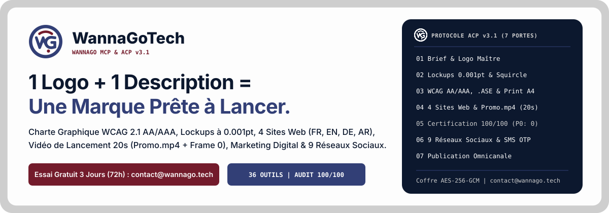
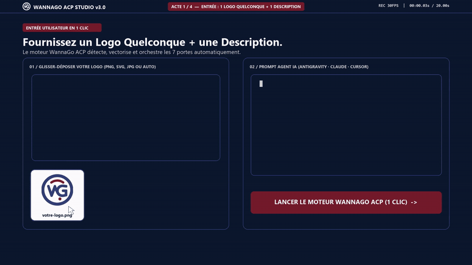

<p align="center">
  
</p>

<p align="center">
  <a href="mailto:contact@wannago.tech?subject=Demande%20Cle%20Essai%20Gratuit%203%20Jours%20WannaGo%20MCP"><strong>Demander une Clé d'Essai Gratuit 72h (contact@wannago.tech)</strong></a>
  &nbsp;|&nbsp;
  <a href="https://wannagotech.github.io/wannago-mcp/"><strong>Site Officiel &amp; Lecteur Vidéo HD (Promo.mp4)</strong></a>
  &nbsp;|&nbsp;
  <a href="https://github.com/WannaGoTech/wannago-mcp/issues/new/choose"><strong>Ouvrir une Demande de Licence</strong></a>
</p>

## Démonstration du Moteur WannaGo ACP en Action (1 Logo Quelconque -> Promo.mp4 20s)

<p align="center">
  <a href="https://wannagotech.github.io/wannago-mcp/#bento">
     Charte, 4 Sites, Promo.mp4 20s & 9 Réseaux" width="100%" />
  </a>
</p>

---

# WannaGo MCP & ACP : Serveur d'Identité de Marque, Sites Web Multilingues, Vidéo 20s (Promo.mp4) & Automatisation de 9 Réseaux Sociaux

> **1 Logo + 1 Description de votre activité = Une Marque Certifiée 100/100 Prête à Lancer en Une Seule Commande.**
> Édité par **WannaGoTech** | Clé d'Essai Gratuit 3 Jours (72h) & Licences Pro : **[contact@wannago.tech](mailto:contact@wannago.tech?subject=Demande%20Cle%20Essai%20Gratuit%203%20Jours%20WannaGo%20MCP)**

---

## Architecture & Proposition de Valeur (FR)

**WannaGo MCP** (`wannago-mcp`) est un serveur **Model Context Protocol (MCP)** et **Agent Control Protocol (ACP)** à 7 portes déterministes. Il permet à votre agent IA (**Google Antigravity**, **Claude Desktop**, **Claude Code**, **Cursor**, **Windsurf**) de transformer **2 entrées simples** dans le chat (**1. Votre Logo** + **2. Votre Description**) en un écosystème complet de production :

1. **Suite Logo Vectorielle & Lockups à Largeur Mathématiquement Égale (`01_Logos/`, `02_Logo_3D_and_Animations/`, `03_Favicons_and_App_Icons/`)**
   - Conservation intacte de votre logo maître ou synthèse vectorielle automatique (`logoPath: "auto"`).
   - Alignement mathématique sous-pixel : `Largeur Ligne 2 == Largeur Ligne 1` à `0.001pt`.
   - Icônes d'application **Squircle 1024x1024** (`22.37%` de rayon continu, `>10%` de marge optique), `favicon.ico` multi-couches et **Studio 3D interactif** (`1.022` échelle).
2. **Palette Certifiée WCAG 2.1 AA/AAA, Nuancier Adobe `.ASE`, Papeterie Print A4 & Signatures Outlook 600px (`04_Headers/`, `05_Email_Signatures/`, `07_Brand_Colors/`)**
   - Calcul de luminance relative et synthèse automatique d'un token d'encre profonde accessible (`>= 5.0:1` sur fond clair).
   - Fichier binaire **Adobe Swatch Exchange (`.ase`)** pour Illustrator, Photoshop et InDesign.
   - En-têtes de lettres A4 vectoriels, bannières réseaux sociaux ajustées sans coupure de texte et signatures email `600px` (`tabular-nums`, isolation BiDi RTL).
3. **Sites Web de Production Multilingues (`FR, EN, DE, AR`), Brand Hubs & Chartes PDF HD (`09_Commercial_Presentations_A4/`, `11_Production_Website/`)**
   - Génération du contrat `DESIGN.md` + **4 Sites Web de Production** (6 anatomies de sections distinctes, grille Bento avec cellule dominante 2x2, 8 états interactifs, support natif RTL Arabe).
   - **4 Brand Hubs HTML5**, **4 Manuels de Charte Graphique PDF HD** et **4 Présentations Commerciales A4**.
4. **Vidéo de Lancement 20 Secondes (`Promo.mp4` + Miniature `Promo.jpg` en Frame 0 + `share-copy.txt`)**
   - Vidéo `1920x1080` (16:9) ou `1080x1920` (9:16) à 30fps synchronisée sur les temps forts musicaux + effets sonores + miniature `Promo.jpg` incrustée directement en **Frame 0** pour un affichage immédiat sur X, LinkedIn, Slack et Discord.
5. **Création de Comptes (Navigateur & Téléphone Mobile Android) + Gestion de 9 Réseaux Sociaux**
   - Automatisation complète sur **X (Twitter), LinkedIn, Instagram, Facebook, TikTok, YouTube, Bluesky, Threads et Reddit** : création de comptes avec extraction automatique des codes SMS OTP sur téléphone Android connecté via ADB, publication (`dryRun` et direct), planification, analytiques, boîte de réception, réponses, DM et veille de tendances.

---

## Essai Gratuit 3 Jours (72h) & Clé de Sécurité (`WANNAGO_API_KEY`)

L'exécution des 23 outils de **WannaGo MCP** est protégée par une clé de licence cryptographique signée (`WANNAGO_API_KEY`) qui déchiffre les moteurs en mémoire vive (RAM) :

| Formule | Préfixe de Clé | Durée & Fonctionnement | Obtenir une Clé |
| :--- | :--- | :--- | :--- |
| **Essai Gratuit 3 Jours** | `wgo_trial_...` | **72 heures** d'accès complet aux 23 outils MCP & ACP, puis arrêt automatique. | Écrire à **[contact@wannago.tech](mailto:contact@wannago.tech?subject=Demande%20Cle%20Essai%20Gratuit%203%20Jours%20WannaGo%20MCP)** |
| **Abonnement Pro / Enterprise** | `wgo_live_...` | Mensuel (30j), Annuel (365j) ou Enterprise multi-postes sans interruption. | Écrire à **[contact@wannago.tech](mailto:contact@wannago.tech?subject=Abonnement%20WannaGo%20MCP%20Pro)** |

---

## Guide d'Intégration Pas-à-Pas (Installation en 2 Minutes)

### Prérequis Système
- **Node.js** `>= 20`
- **Python** `>= 3.10` avec `pymupdf`, `Pillow`, `numpy` :
  ```bash
  pip install pymupdf Pillow numpy
  ```
- **FFmpeg** installé sur le système (pour le rendu de la vidéo 20s `Promo.mp4`).

### Étape 1 : Cloner le Plugin WannaGo
```bash
git clone https://github.com/WannaGoTech/wannago-mcp.git
cd wannago-mcp
npm install --omit=dev
```

### Étape 2 : Connecter à votre Agent IA

#### A. Intégration dans **Google Antigravity**
Option 1 (Plugin natif) :
```bash
# Windows (PowerShell)
Copy-Item -Recurse . "$HOME\.gemini\config\plugins\wannago"

# macOS / Linux
cp -R . ~/.gemini/config/plugins/wannago
```
Option 2 (Fichier `~/.gemini/config/mcp_config.json`) :
```json
{
  "mcpServers": {
    "wannago-mcp": {
      "command": "node",
      "args": ["/chemin/absolu/vers/wannago-mcp/dist/index.js"],
      "env": {
        "WANNAGO_API_KEY": "wgo_trial_VOTRE_CLE_RECUE_PAR_EMAIL"
      }
    }
  }
}
```

#### B. Intégration dans **Claude Desktop / Claude Code**
```bash
claude mcp add wannago-mcp -e WANNAGO_API_KEY=wgo_trial_VOTRE_CLE -- node /chemin/absolu/vers/wannago-mcp/dist/index.js
```

#### C. Intégration dans **Cursor / Windsurf / VS Code**
Ajoutez dans `.cursor/mcp.json` ou `.vscode/mcp.json` :
```json
{
  "mcpServers": {
    "wannago-mcp": {
      "command": "node",
      "args": ["/chemin/absolu/vers/wannago-mcp/dist/index.js"],
      "env": {
        "WANNAGO_API_KEY": "wgo_trial_VOTRE_CLE_RECUE_PAR_EMAIL"
      }
    }
  }
}
```

### Étape 3 : Activation Directe dans le Chat (Sans Redémarrer)
Vous pouvez activer votre clé reçue de **contact@wannago.tech** directement dans le chat de votre agent :
> `"Active ma clé WannaGo : wgo_trial_..."`

Puis lancez votre marque en une seule instruction :
> `"Crée toute mon identité de marque, mes 4 sites web et ma vidéo Promo.mp4 de 20s : Logo = auto, Marque = WannaCloud, Description = Cloud médical souverain et imagerie diagnostique."`

---

## Les 7 Portes Déterministes du Protocole ACP (`acp_launch_brand_one_shot`)

| Porte ACP | Vérification & Livrables Générés |
| :--- | :--- |
| **`GATE_1_BRIEF_AND_LOGO`** | Validation des 2 entrées (`logoPath` + `businessDescription`) et respect de la règle du colophon institutionnel. |
| **`GATE_2_LOGO_SUITE_AND_EQUAL_WIDTH`** | Lockups vectoriels (`Largeur Ligne 2 == Largeur Ligne 1` à `0.001pt`), icônes Squircle `1024px`, `favicon.ico` et Studio 3D. |
| **`GATE_3_WCAG_TOKENS_AND_STATIONERY`** | Palette certifiée WCAG 2.1 AA/AAA, fichier binaire `.ase`, papeterie A4, signatures `600px` et **Packs Réseaux Sociaux pour les 9 plateformes (Bios FR/EN/DE/AR, Descriptions longues, Avatars `800x800` & Bannières de Couverture)**. |
| **`GATE_4_WEB_AND_COMMERCIAL_SUITE`** | Contrat `DESIGN.md`, 4 Sites Web (`FR/EN/DE/AR`), **Thème Bloc WordPress (`wordpress-studio` MCP) & Pressable (`pressable` MCP — Partenaire Officiel Automattic : support & création site 100% GRATUITS, seul l'hébergement premium est facturé)**, **API REST Live (`everything-api` + OpenAPI 3.1)** et Vidéo 20s (`Promo.mp4`). |
| **`GATE_5_11_SKILL_AUDIT_CERTIFICATION`** | Audit statique et mathématique certifiant `0 anomalie (P0 0 / P1 0 / P2 0)` et score `100 / 100`. |
| **`GATE_6_SOCIAL_ACCOUNTS_AND_PHONE_ARTEMIS`** | Création et configuration des Pages & Comptes sur les 9 réseaux sociaux avec sélection de l'administrateur propriétaire (`adminOwnerName` Super Admin sur LinkedIn, Facebook, YouTube, Reddit & Admin délégué sur X, Instagram, Threads, TikTok, Bluesky). |
| **`GATE_7_BRAND_LAUNCH_CAMPAIGN`** | Prévisualisation (`dryRun: true`) ou publication de la campagne de lancement avec `Promo.mp4` et `share-copy.txt`. |

---

## Offre Partenaire Officiel Automattic (WordPress MCP & Pressable MCP) + Isolation Collaborateur Mono-Site

- **Partenaire Officiel Automattic** : **WannaGoTech** fournit des tarifs préférentiels partenaires sur l'hébergement managé **WordPress** et **Pressable**.
- **Création du site & support technique 100 % GRATUITS (`0 EUR`)** : Nous ne facturons jamais la création du site ni le support technique — **nous facturons uniquement l'hébergement premium**. En cas de blocage, écrivez à **[contact@wannago.tech](mailto:contact@wannago.tech)**.
- **Isolation Collaborateur Mono-Site (`wannago_pressable_collaborator_isolation`)** : Lors de la connexion ou du déploiement sur Pressable/WordPress, chaque utilisateur (`collaboratorEmail`) est ajouté **exclusivement comme Collaborateur de son propre site unique**, gardant tous les autres sites WannaGoTech **100 % isolés et invisibles**.

---

## Liste Complète des 36 Outils MCP Exposés (WannaGoTech v3.1 Souverain)

### 1. Découverte Interactive par Chat (Zéro Invention), Licence, ACP, Identité de Marque, Sites Web (WordPress/Pressable Isolé), Everything-API & Vidéo Promo 20s
- `wannago_interactive_discovery` : **Garde-fou Zéro Invention** — force l'agent à demander les inspirations visuelles, préférences/tabous couleurs, coordonnées réelles et avis de l'utilisateur dans le chat avant toute création.
- `wannago_verify_license` : Vérifie ou active en session une clé `wgo_trial_...` (3 jours) ou `wgo_live_...`.
- `acp_launch_brand_one_shot` : Exécute les 7 Portes ACP en une seule commande à partir du Logo + Description + Inspirations.
- `acp_get_status` : Retourne l'état exact des 7 Portes ACP et la prochaine instruction déterministe pour l'agent.
- `wannago_generate_brand_kit` : Génère les 12 dossiers du Brand Kit + 4 Sites Web + Thème WordPress + Everything-API + Vidéo 20s (`Promo.mp4`) + Audit `100/100`.
- `wannago_generate_social_profile_packs` : Génère les Bios calibrées (FR/EN/DE/AR), Descriptions longues, Photos de profil `800x800` et Bannières de couverture aux dimensions exactes des 9 plateformes.
- `wannago_url_to_everything_api` : Embarque `https://github.com/edsadr/everything-api` dans le projet (`12_Everything_API/`) et transforme tout lien de site web fourni par l'utilisateur en API REST JSON + OpenAPI 3.1.
- `wannago_wordpress_pressable_deploy` : Génère le thème bloc WordPress certifié et orchestre le déploiement via `wordpress-studio` MCP ou `pressable` MCP (Partenaire Officiel Automattic — support site web gratuit à `contact@wannago.tech`).
- `wannago_pressable_collaborator_isolation` : Configure l'accès Collaborateur Pressable/WordPress restreint au seul site de l'utilisateur (autres sites WannaGoTech 100 % isolés).
- `wannago_generate_promo_video` : Génère une vidéo de lancement 20s (`Promo.mp4`) + miniature Frame 0 (`Promo.jpg`) + `Promo-plan.md` + `share-copy.txt`.
- `wannago_audit_design` : Exécute le scanner statique de qualité WannaGo (`0 anomalie`) sur n'importe quel dossier.

### 2. Marketing Digital Souverain, Audit Image Anti-IA, LinkedIn Sans Sales Navigator, Heures de Pointe, Stratégie (.md), Rappels, Rapports & Publicités
- `wannago_design_social_post` : Génère des visuels de posts sociaux en `1080x1350` (4:5 portrait), `1080x1080` (1:1), `1080x1920` (9:16), `1920x1080` (16:9) et **Carrousels PDF natifs LinkedIn (`Carousel_LinkedIn_<Marque>.pdf`)**.
- `wannago_audit_visual_and_post` : Audite et calibre optiquement toute image générée (micro-grain capteur ISO-100, compression des néons IA, micro-contraste optique) pour qu'elle ne fasse jamais "générée par IA" et valide les Safe Zones UI de chaque réseau social.
- `wannago_detect_peak_hours` : Détecte les heures de pointe algorithmiques ("Golden Velocity Windows") par plateforme, fuseau horaire et cible — interdisant toute publication au hasard.
- `wannago_linkedin_sovereign_suite` : Gestion complète de LinkedIn **sans Sales Navigator ni abonnement Pro** (requêtes Booléennes, Google X-Ray `site:linkedin.com/in/`, commentateurs de posts viraux, post Dwell-Time 0 lien dans le corps + lien en 1er commentaire, CRM local `LINKEDIN_PROSPECTS_CRM.md`).
- `wannago_content_strategy_planner` : Crée une stratégie de contenu claire et génère le calendrier de suivi daté `CONTENT_STRATEGY_CALENDAR.md`.
- `wannago_schedule_reminders` : Planifie et gère les rappels (`.data/marketing_reminders.json`) avant chaque échéance de création ou publication.
- `wannago_generate_marketing_report` : Génère des rapports exécutifs datés (`MARKETING_REPORT_<DATE>.md`).
- `wannago_ads_campaign_manager` : Architecte de campagnes publicitaires payantes TOF/MOF/BOF (`ADS_CAMPAIGN_MASTERPLAN.md`), variantes A/B Anti-IA, UTM et coupe-circuit CPA/ROAS sur Meta Ads, Google Ads, LinkedIn Ads, TikTok Ads et X Ads.

### 3. Automatisation Mobile Android, Gouvernance Super Admin & Création de Comptes Sociaux
- `wannago_phone_status` : Détecte les téléphones Android connectés par ADB (USB ou Wi-Fi).
- `wannago_phone_read_otp` : Extrait automatiquement les codes SMS OTP (4 à 8 chiffres) reçus sur le téléphone pour valider les inscriptions/2FA.
- `wannago_phone_artemis_task` : Exécute une tâche mobile en langage naturel sur le téléphone connecté.
- `wannago_create_social_accounts` : Automatise la création et l'habillage (Bio/Avatar/Couverture) des comptes et Pages de Marque sur les 9 plateformes avec assignation de l'administrateur choisi (`adminOwnerName`).

### 4. Gestion des 9 Réseaux Sociaux (`x`, `linkedin`, `instagram`, `facebook`, `tiktok`, `youtube`, `bluesky`, `threads`, `reddit`)
- `social_list_platforms`, `social_open_login`, `social_check_auth`, `social_publish_post`, `social_schedule_post`, `social_manage_schedules`, `social_get_analytics`, `social_read_inbox`, `social_reply_to_post`, `social_send_dm`, `social_search_posts`, `social_get_trends`, `social_browser_inspect`.

---

## Security Architecture, Permission Boundaries & MCP Tool Safety Annotations

To guarantee enterprise safety and full transparency for AI agents and MCP registries (such as **MCP.Pub**, **Official MCP Registry**, **Glama**, and **Smithery**), **WannaGo MCP v3.1** enforces 5 strict security boundaries:

| Security Control | Implementation & Default Behavior | Affected Tools |
| :--- | :--- | :--- |
| **1. Zero-Invention Human-in-the-Loop Gatekeeper** | The agent is **forbidden from inventing** brand inspirations, colors, contacts, or posts. It must call `wannago_interactive_discovery` and wait for explicit user confirmation in chat before generating or publishing. | `wannago_interactive_discovery`, `acp_launch_brand_one_shot` |
| **2. Read-Only & Scoped Workspace Generation (22 Tools)** | Read-only inspection tools (`acp_get_status`, `wannago_audit_design`, `wannago_audit_visual_and_post`, `wannago_detect_peak_hours`, `social_list_platforms`, `social_check_auth`, `social_get_analytics`, `social_read_inbox`, `social_search_posts`, `social_get_trends`) have **zero external write side-effects** (`readOnlyHint: true`). File generators write strictly inside the user-specified `outputDir`. | All Audit, Analytics, Discovery & Brand Kit tools |
| **3. Mandatory Dry-Run Preview Before Publishing (`dryRun: true`)** | Social publishing tools support `dryRun: true` to populate the composer and capture a local verification screenshot **without clicking Publish**. Live publication requires explicit user approval in chat. | `social_publish_post`, `social_reply_to_post`, `social_send_dm` |
| **4. Single-Site Collaborator Isolation (Zero Shared Credentials)** | No third-party credentials are bundled. When deploying to WordPress/Pressable, `wannago_pressable_collaborator_isolation` scopes the user's `collaboratorEmail` **strictly to their single dedicated site** (`otherWannaGoTechSitesVisible: false`, `masterAccountListingBlocked: true`). | `wannago_pressable_collaborator_isolation`, `wannago_wordpress_pressable_deploy` |
| **5. Strict Opt-In Hardware Bridge (Android ADB)** | Android ADB tools (`wannago_phone_*`) are **100% opt-in (`socialAccountMode: "skip"` by default)** and only execute when a user physically connects their own device via USB debugging and explicitly requests mobile automation. | `wannago_phone_status`, `wannago_phone_read_otp`, `wannago_phone_artemis_task` |

---

## Why Choose WannaGo MCP v3.1 vs. Single-Purpose Alternatives (Facet, SEO Desk, APICK MCP)

| Capability / Criterion | **WannaGo MCP & ACP v3.1 (WannaGoTech)** | **Facet** | **SEO Desk** | **APICK MCP** |
| :--- | :--- | :--- | :--- | :--- |
| **Core Scope** | **End-to-End Brand Identity, Multilingual Web, 20s Video (`Promo.mp4`), Anti-AI Optical Audit, SEO/AEO & 9-Platform Social/Marketing (36 Tools)** | Responsive viewport screenshot tester only | Read-only SEO/AEO website auditor (4 tools) | Korea-specific API utility wrapper |
| **Responsive & Anti-AI Visual Auditing** | **Built-in** (`wannago_audit_design` + `wannago_audit_visual_and_post` with ISO-100 optical calibration & mobile UI safe-zone verification) | Viewport screenshots only | Not supported | Not supported |
| **SEO, AEO, Schema.org & Multilingual Web** | **Built-in** (Generates 4 full `FR/EN/DE/AR` websites + `Schema.org` JSON-LD + `sitemap.xml` + `robots.txt` + WordPress Block Theme) | Not supported | Audit only (does not generate sites) | Not supported |
| **Launch Video (`Promo.mp4`) & Social Carousels** | **Built-in** (20s 30fps `Promo.mp4` + Frame-0 `Promo.jpg` + Native LinkedIn PDF Carousels `1080x1350`) | Not supported | Not supported | Not supported |
| **LinkedIn Pro-Free & Peak-Hour Engine** | **Built-in** (`wannago_linkedin_sovereign_suite` without Sales Navigator + `wannago_detect_peak_hours` + `CONTENT_STRATEGY_CALENDAR.md`) | Not supported | Not supported | Not supported |
| **Transport & License Metadata** | `stdio` + Secured `HTTP/SSE` (`/sse`, `/health`) + SPDX `MIT` Client Wrapper & AES-256-GCM Vault | `stdio` only | `stdio` only | `stdio` / HTTP |

---

## English Overview : WannaGo MCP & ACP Server v3.1

**WannaGo MCP** (`wannago-mcp`) is an enterprise **Model Context Protocol (MCP)** server and **7-Gate Agent Control Protocol (ACP)** engine built by **WannaGoTech** exposing **36 sovereign tools**. With mandatory **Zero-Invention Interactive Chat Discovery** (`wannago_interactive_discovery`), provide your **Logo**, **Business Description**, and **Visual Inspirations** to generate a **100/100 WCAG 2.1 AA/AAA Brand Identity Kit**, **4 Production Websites (`FR, EN, DE, AR`) + Single-Site Isolated WordPress/Pressable Deployment**, a **20-Second Beat-Synced Launch Video (`Promo.mp4` with Frame-0 poster `Promo.jpg`)**, **Anti-AI Optical Image Calibration**, **LinkedIn Growth Without Sales Navigator**, **Peak-Hour Scheduling**, and **9-Platform Social Media Automation**.

- **Request your 3-Day Free Trial Key (`wgo_trial_...`, 72h auto-stop) or Pro License (`wgo_live_...`)**: Email **[contact@wannago.tech](mailto:contact@wannago.tech?subject=WannaGo%20MCP%203-Day%20Free%20Trial%20Key)**

---

## Colophon & Attribution Institutionnelle
WannaGo MCP & ACP est une plateforme propriétaire développée par **WannaGoTech** ([contact@wannago.tech](mailto:contact@wannago.tech)).
